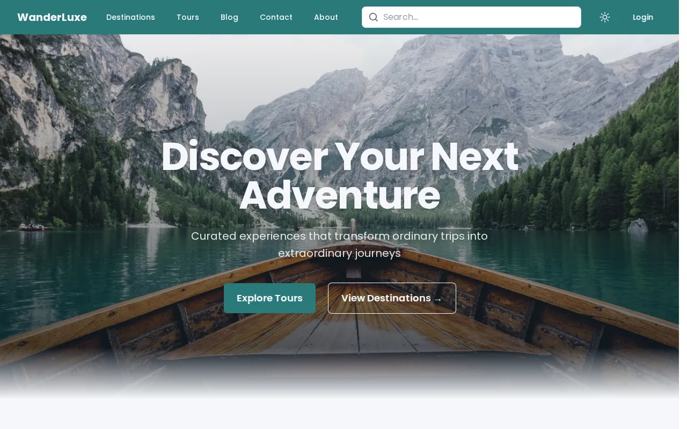
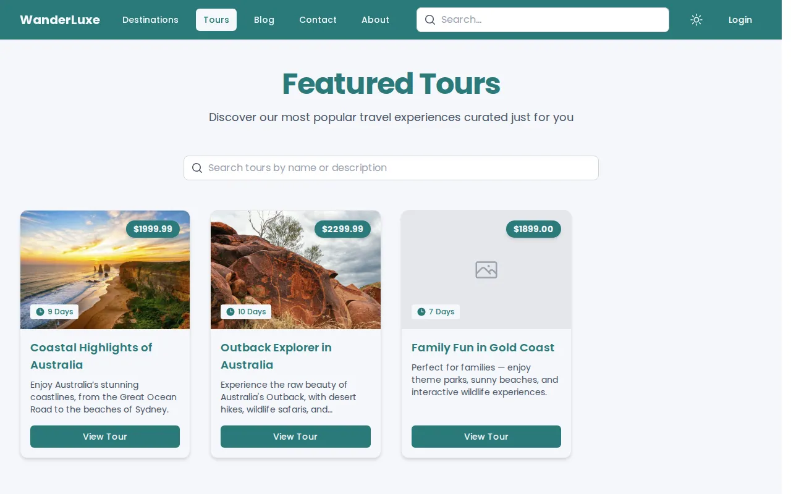
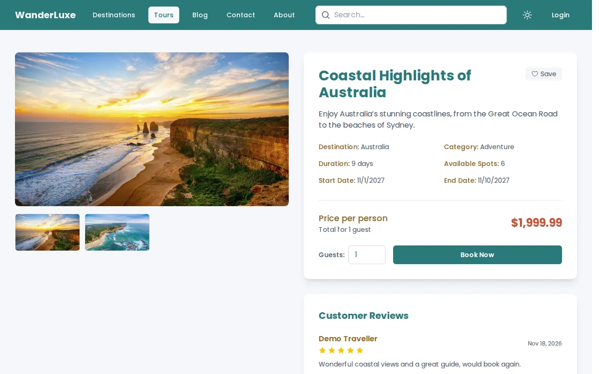
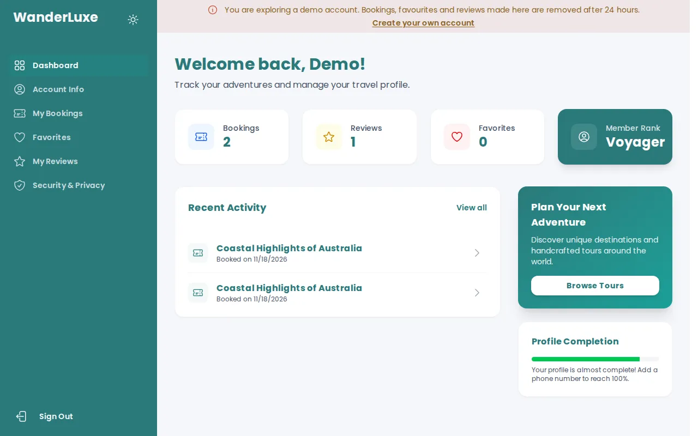
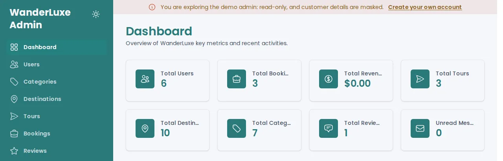
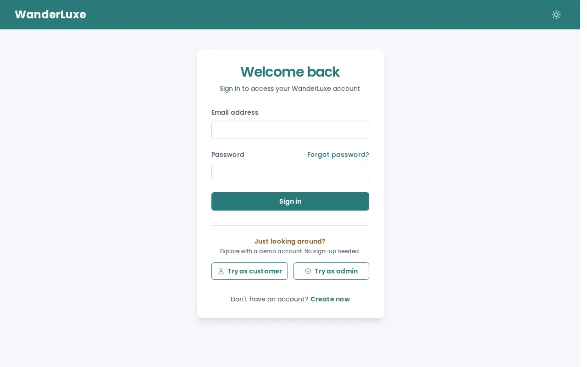
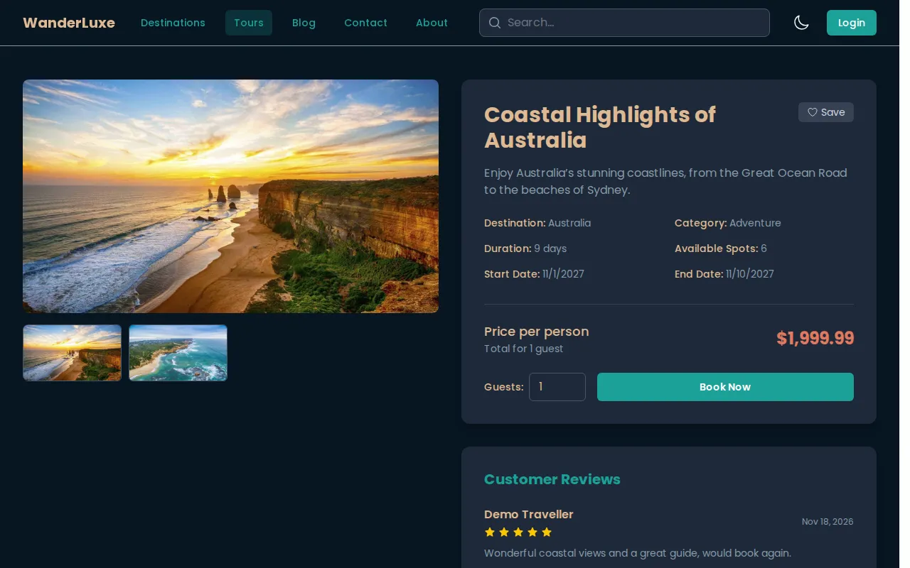
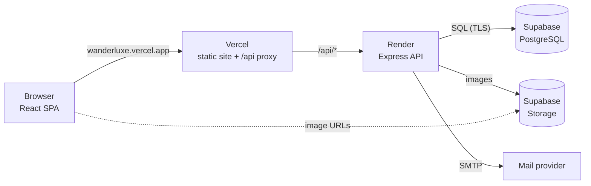

# WanderLuxe

**A full-stack travel-agency app: browse tours and destinations, book a trip, manage it from your profile, and run the whole catalogue from an admin panel.**

**Live demo: [wanderluxe.vercel.app](https://wanderluxe.vercel.app)**. On the sign-in page, *Try as customer* or *Try as admin* opens a demo account without signing up. The demo admin is read-only and sees customers' personal details masked.

> Hosted on free tiers: if nobody has visited for a while, the first request can take up to a minute while the API wakes up.



| | |
|---|---|
|  |  |
|  |  |
|  |  |

<p align="center">
  
  &nbsp;
  
</p>

## What it does

- **Visitors** browse destinations, tours, and blog posts, search the catalogue, read reviews, subscribe to the newsletter (double opt-in), and use the contact form.
- **Customers** book tours with live seat counts and get e-mail confirmations, cancel up to three days before departure (cancelled trips stay in their history), save favourites, review tours they have travelled on, and manage their profile and password.
- **Admins** manage tours (with image galleries), destinations, categories, blog posts, users and roles, bookings (moving each through pending → confirmed → completed, with a history of every change), reviews, newsletter subscribers, and contact messages, from a dashboard with key metrics.

## Engineering highlights

- **Sessions done properly.** The short-lived access token lives in memory only. The refresh token is an opaque, rotating value in an `HttpOnly; Secure; SameSite=Strict` cookie, and the database stores only its hash. Reusing an old token revokes the whole session, and logout or a password change ends sessions on the server. Vercel proxies `/api`, so the cookie is first-party.
- **Defence in depth.** zod validation on every request, role checks from the signed token, rate limiting on auth and forms, helmet headers, a least-privilege database role, image uploads re-encoded with sharp, and hashed reset tokens.
- **No overselling.** Seats are taken with a single conditional `UPDATE`, which is tested with concurrent bookings.
- **A real booking lifecycle.** One transition table decides which status changes are allowed; every change is recorded in the same transaction, seats are released exactly once, and finished trips complete themselves without a cron job. E-mails go out only after the database commits, so a mail outage can't break a booking.
- **Demo accounts that can't do damage.** A server-side write allow-list blocks changes, responses are masked for the demo admin, and the demo customer's bookings are cleaned up automatically after 24 hours. The demo customer always has a finished trip to review, and those reviews are only visible to the demo account.
- **Tested at three levels.** API integration tests against a real PostgreSQL, React component tests, and Playwright end-to-end tests that include axe accessibility checks. CI runs all of them on every PR, and the API deploys only when CI is green.
- **Accessible and findable.** Lighthouse gives the main pages 100 for accessibility, best practices and SEO. They have per-page titles, a meta description, social preview tags, a sitemap, ordered headings and a dark mode.

## Architecture



More detail is in [docs/ARCHITECTURE.md](docs/ARCHITECTURE.md): the request lifecycle, the auth flow and the folder conventions.

| Layer | Tech |
|---|---|
| Frontend | React 19, Vite 8 (Rolldown), TypeScript 6, React Router 7, TanStack Query 5, Zustand, Tailwind CSS 4, Headless UI, zod |
| Backend | Node.js (ESM), Express 5, TypeScript 6, Sequelize 6, zod, JWT, bcrypt, helmet, multer + sharp, nodemailer |
| Database | PostgreSQL 17 (works with 13+) |
| Hosting | Vercel (frontend), Render (API), Supabase (PostgreSQL + Storage), GitHub Actions (CI, keep-alive) |
| Local infra | Docker Compose: PostgreSQL + [Mailpit](https://mailpit.axllent.org/) (catches outgoing e-mail) |
| Tests | Vitest + Supertest (API, real PostgreSQL), Vitest + Testing Library (React), Playwright + axe-core (end-to-end) |

---

# For developers

## Repository layout

```
wanderluxe/
├── backend/                Express API (npm workspace "wanderluxe-back")
│   ├── src/
│   │   ├── config/env.ts   validated configuration — every env var is declared here
│   │   ├── routes/         URL → middleware chain (auth, validation, rate limits) → controller
│   │   ├── controllers/    request handling + business rules
│   │   ├── validators/     zod schemas for every request
│   │   ├── middlewares/    auth, validation, rate limiting, uploads, error handling
│   │   ├── db/             Sequelize models, migrations, seeders, sequelize-cli config
│   │   ├── lib/            logger, storage drivers (local / Supabase)
│   │   ├── emails/         HTML e-mail templates
│   │   └── utils/          tokens, pagination, security helpers, mailer, …
│   ├── tests/              API integration tests (rebuild a dedicated test DB)
│   └── scripts/            create-dev-users.ts, create-demo-users.ts
├── frontend/               React SPA (npm workspace "wanderluxe-frontend")
│   └── src/                api/ hooks/ queries/ store/ router/ pages/ admin/ components/ shared/
├── database/
│   ├── dump/               the private production dump (git-ignored — see database/README.md)
│   ├── schema/baseline.sql schema + public catalogue data, no personal data (tracked)
│   ├── docker/initdb/      creates the least-privilege app role + test DB on first start
│   └── scripts/db.sh       import / reset / psql helper
├── docs/                   ARCHITECTURE.md, TESTING.md, FEATURE_PLANS.md, screenshots/
├── e2e/                    Playwright end-to-end tests (npm workspace "wanderluxe-e2e")
├── docker-compose.yml      PostgreSQL + Mailpit for local development
└── package.json            npm workspaces + root scripts
```

## Quick start

Prerequisites:
- **Node.js ≥ 22.12** (24 recommended, see `.nvmrc`; Vite 8 and Vitest 5 need it) and npm 10+
- **Docker** with the Compose plugin, for PostgreSQL and Mailpit

```bash
npm install                 # installs both workspaces
npm run setup               # creates .env, backend/.env with random local secrets (never overwrites)
npm run db:up               # starts PostgreSQL + Mailpit and waits until healthy
npm run db:import           # imports database/dump/wanderluxe.sql (or the baseline) into an EMPTY db
npm run db:migrate          # applies schema migrations
npm run db:dev-users        # optional: admin@wanderluxe.local / customer@wanderluxe.local
npm run db:demo-users       # optional: the demo accounts behind "Try as customer / admin" (needs DEMO_MODE=true)
npm run dev                 # API on :3000 and web app on :5173, with hot reload
```

Open http://localhost:5173. E-mails such as booking confirmations, password resets and newsletter confirmations appear at http://localhost:8025.

The development account passwords are `DEV_ADMIN_PASSWORD` / `DEV_CUSTOMER_PASSWORD` in `backend/.env.example`. They work only against a local database.

Step-by-step details, running without Docker, and troubleshooting are in **[LOCAL_DEVELOPMENT.md](LOCAL_DEVELOPMENT.md)**.

## Root scripts

| Command | What it does |
|---|---|
| `npm run dev` | Backend (`tsx watch`) and frontend (Vite) together |
| `npm run dev:backend` / `dev:frontend` | One side only |
| `npm run build` | Type-checks + compiles the API to `backend/dist`, builds the SPA to `frontend/dist` |
| `npm start` | Runs the compiled API (`NODE_ENV=production`) |
| `npm run lint` / `typecheck` / `test` | Across both workspaces |
| `npm run check` | lint + typecheck + test + build: run this before pushing |
| `npm run test:e2e` | Playwright browser tests against the local stack (needs `npm run db:up`; see docs/TESTING.md) |
| `npm run db:up` / `db:down` | Start / stop the docker services (data is kept) |
| `npm run db:import` | Import the dump into an empty database (refuses otherwise) |
| `npm run db:migrate` | Apply pending migrations (`db:migrate:test` for the test DB) |
| `npm run db:reset` | **Delete** all local data (asks you to type the DB name) |
| `npm run db:psql` | psql shell inside the container |

Run a script in one workspace with `npm run <script> -w backend` or `-w frontend`.

## Environment variables

| File | Purpose | Committed? |
|---|---|---|
| `.env.example` → `.env` | Docker Compose: database names, passwords, ports | example only |
| `backend/.env.example` → `backend/.env` | API configuration (DB, JWT, SMTP, storage, CORS, rate limits) | example only |
| `frontend/.env.development` | `VITE_API_URL=/api` + dev proxy target | yes (no secrets) |
| `frontend/.env.example` | Documents frontend variables for production builds | yes |

Rules:
- **Everything prefixed `VITE_` is shipped to browsers.** Only public values (the API URL) belong there.
- Secrets live in `backend/.env` only, and that file is git-ignored.
- The backend validates its configuration at start-up. A missing or malformed variable produces a readable error listing variable names only, never values.

The full variable reference is in `backend/.env.example` and [LOCAL_DEVELOPMENT.md](LOCAL_DEVELOPMENT.md#environment-variables).

## Testing

```bash
npm run db:up      # tests need PostgreSQL
npm test           # 83 API tests + 79 frontend tests (npm run test:e2e: 20 browser tests)
```

The API suite rebuilds the dedicated `wanderluxe_test` database before every run, so it never touches your development data. See [docs/TESTING.md](docs/TESTING.md).

**CI.** [`.github/workflows/ci.yml`](.github/workflows/ci.yml) runs on every pull request and every push to `main`, as two jobs:
- `npm run check` (lint, typecheck, both unit/integration suites and both builds) against a PostgreSQL 17 service;
- the Playwright suite on the docker compose stack.

`main` deploys automatically (Render waits for CI), so only merge when CI is green.

## Git workflow

- This is a single repository. It was consolidated from the former `travel-back` and `travel-front` repositories with their full history preserved. See [REPOSITORY_MIGRATION.md](REPOSITORY_MIGRATION.md).
- Repository-level identity: `ArnoSahakyan <sahakyan.arno@gmail.com>`.
- Suggested flow:
  1. Branch from `main`.
  2. Make small commits (`feat:`, `fix:`, `chore:`, `docs:` prefixes).
  3. Run `npm run check`.
  4. Open a PR.
- Remote: `git@github.com:ArnoSahakyan/wanderluxe.git`. Pushing to `main` redeploys on Render and Vercel ([DEPLOYMENT.md](DEPLOYMENT.md)).

## Documentation

| Document | Contents |
|---|---|
| [LOCAL_DEVELOPMENT.md](LOCAL_DEVELOPMENT.md) | Setup in detail, env var reference, images, e-mail, troubleshooting |
| [DEPLOYMENT.md](DEPLOYMENT.md) | Supabase (database) + Render (API) + Vercel (frontend), step by step |
| [docs/ARCHITECTURE.md](docs/ARCHITECTURE.md) | How the pieces fit, request lifecycle, auth flow, conventions |
| [docs/TESTING.md](docs/TESTING.md) | Test strategy, how to run and write tests |
| [docs/FEATURE_PLANS.md](docs/FEATURE_PLANS.md) | Plans for the next product features |
| [database/README.md](database/README.md) | Dump handling, import/restore, migrations, roles |
| [PROJECT_AUDIT.md](PROJECT_AUDIT.md) | Stage-1 discovery: inventory, API list, findings |
| [SECURITY_AUDIT.md](SECURITY_AUDIT.md) | Vulnerabilities, severity and fix status |
| [DATABASE_AUDIT.md](DATABASE_AUDIT.md) | Schema review, defects, migrations |
| [REPOSITORY_MIGRATION.md](REPOSITORY_MIGRATION.md) | How the two repositories were merged |
| [FINAL_AUDIT_REPORT.md](FINAL_AUDIT_REPORT.md) | What changed, verification results, open items |
